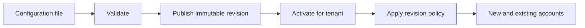

# Configuration and catalog revisions

`BursarConfig` brings the pricing, credit, access, and commerce models together in one strict versioned document. Python and TypeScript validate the same schema, so one active catalog revision produces the same policy decisions in both SDKs.

## Start with a configuration file

Run `bursar config init bursar.yaml` or `npx bursar-config init bursar.yaml` to generate the packaged starter. The same version 1 schema defines configuration and stored catalogs. Plans deny operations by default: explicitly list allowed operations, use `all`, or use `none`. Explicitly declared measures are required by default; set `required: false` to treat an omitted measure as zero. A flat charge requires no caller-supplied measures. Rate cards hold reusable pricing rules; rates determine a quote while the ledger records actual grants and charges. The `on_signup` grant is distinct from a recurring plan allowance and a subscription cycle grant.

Provider object IDs may have `test`, `live`, and `sandbox` bindings. A tenant has one active policy catalog containing all authored bindings; each provider operation selects the ID for its store’s financial environment. A missing binding makes that offer unavailable in that environment. Use `loadConfigFile(path, environment)` from `@zonastery/bursar/node` for a validated publishable document, or `loadRawConfigFile` to parse without validation. A bare provider ID is scoped to the explicit environment at load or publication. Publishing a catalog with only one environment binding replaces the active catalog and leaves the other environments without that offer. Credentials belong in runtime adapters, not the file.

## One document owns product policy

Each top-level section owns one part of the product model:

| Section        | Responsibility                                                        |
| -------------- | --------------------------------------------------------------------- |
| `pricing`      | Metered operations, measures, dimensions, and reusable rate cards     |
| `credits`      | Credit buckets, spending policies, grants, and display conversion     |
| `entitlements` | Typed product features                                                |
| `admission`    | Reusable concurrency policies                                         |
| `plans`        | Product access, allowances, quotas, and policy references             |
| `commerce`     | Payment providers, offers, plan changes, and auto-recharge guardrails |
| `catalog`      | Catalog-wide settings, including the default signup plan              |

Keeping these domains in one document lets validation reject broken cross-references before publication. A plan cannot name an unknown rate card, an offer cannot name an unknown plan, and a price rule cannot use a measure or dimension that its operation does not declare.

## Validation is shared across SDKs

Pydantic defines the Python contract and generates the published JSON Schema. TypeScript validates the same contract with Ajv. Unknown fields and legacy shapes are rejected instead of being ignored.

The validation boundary also enforces these accounting rules:

- Exact decimal values use strings instead of binary floating-point numbers
- Every integer stays within JavaScript's exact safe-integer range
- Offer prices use integer minor units with an explicit currency
- Matcher operators agree with their declared dimension types
- Expressions reference only measures declared by their operation
- Credit buckets and allowance priorities share one collision-free ordering namespace
- Subscription-backed plans declare when catalog revisions take effect

The packaged starter is a small document:

```yaml
# yaml-language-server: $schema=https://zonastery.github.io/bursar/pricing-config.schema.json
version: 1
catalog: { default_plan: free }
credits: { on_signup: "20" }
pricing:
  operations:
    export_report:
      charge: { type: flat, amount: "2" }
plans:
  free:
    display_name: Free
    allowed_operations: [export_report]
```

Run `bursar config init bursar.yaml` to create this starter, and `bursar config validate bursar.yaml` to validate it. Use the [configuration schema](https://zonastery.github.io/bursar/pricing-config.schema.json) for editor completion.

## Provider references and rate cards

A Stripe or Dodo offer references an ID beneath the declared provider; the reference kind is inferred from that provider. Custom providers still require `type: custom_object` and `object_kind`.

```yaml
commerce:
  providers:
    stripe: { type: stripe }
  offers:
    monthly:
      type: subscription
      display_name: Monthly
      plan: pro
      billing_interval: { unit: month, count: 1 }
      price: { amount_minor: 1000, currency: USD }
      providers:
        stripe:
          price_id: { test: price_test, live: price_live }
```

A single rate card is selected automatically regardless of its name. When multiple cards exist, plans that allow operations must choose a `rate_card`. An operation's inline `charge` supplies the base price for each root card that does not define that operation; explicit card prices and inherited rules take precedence. Null `on_signup` or `charge` has the same effect as omission.

## Catalog revisions are immutable

Publishing validates the document and stores an immutable catalog revision. Activation selects the revision used for new pricing and policy decisions within one tenant.



Each revision has a SHA-256 digest of its canonical document. Publishing the same digest reuses the existing revision, while activation records history and leaves prior revisions available for audit and rollback.

The catalog exposes three lifecycle operations:

| Operation            | Effect                                                                  |
| -------------------- | ----------------------------------------------------------------------- |
| Publish a draft      | Validate and store a revision without changing the active catalog       |
| Activate a revision  | Select one active revision for the tenant and schedule applicable moves |
| Publish and activate | Validate, store, and activate one document in a single workflow         |

Use the [CLI reference](../cli.mdx) for exact `config validate`, `set`, `get`, `list`, `activate`, `diff`, and `schema` commands. Use the generated SDK reference for programmatic catalog signatures.

## Revision policy controls rollout

Plans define when an activated revision reaches assigned accounts. `immediate` applies the new revision at activation, `next_renewal` waits for the next subscription renewal, and `new_assignments_only` leaves existing assignments on their current revision until an explicit migration.

Subscription-backed plans default to `next_renewal`; other plans default to `immediate`. Declare the policy explicitly when a rollout delay changes customer-visible pricing or access.

## Public projections exclude private configuration

The active configuration remains the internal policy document. Catalog projection methods expose only the product fields needed by a client application and keep provider identifiers, internal policies, and private configuration out of public responses.

In the JavaScript SDK, `await bursar.catalog.publicView()` scopes storefront offers to the runtime provider environment and registered commerce providers. An offer needs a binding for at least one provider in that scope. Plans remain visible even when no eligible subscription offer is available; top-ups are filtered by the same provider binding rule. This projection does not replace checkout's availability and trusted-region checks.

For offline inspection of every configured offer, call the standalone projection without a scope:

```ts
import { loadConfigFromDict, projectPublicCatalog } from "@zonastery/bursar";

const config = loadConfigFromDict(document);
const allConfiguredOffers = projectPublicCatalog(config);
```

Passing a scope with `providerEnvironment` and optional `providers` to `projectPublicCatalog` selects the offers with matching provider bindings instead.

## Related

- [Pricing model](./pricing.mdx): operations, rate cards, and charge types
- [Plans and access control](./plans.mdx): allowances, entitlements, quotas, and revision policy
- [Billing and commerce](./billing.mdx): providers, offers, subscriptions, and auto-recharge
- [Create your first metered charge](../quickstart.mdx): validate and publish a minimal configuration
